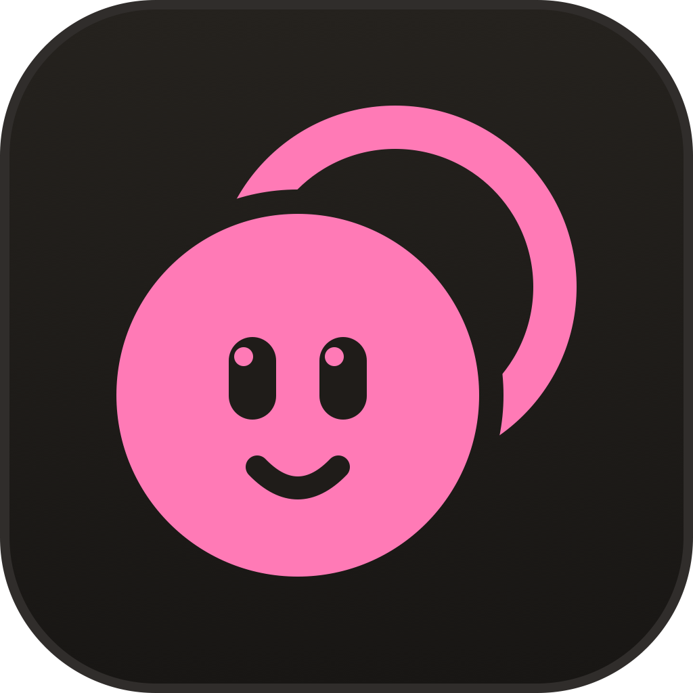
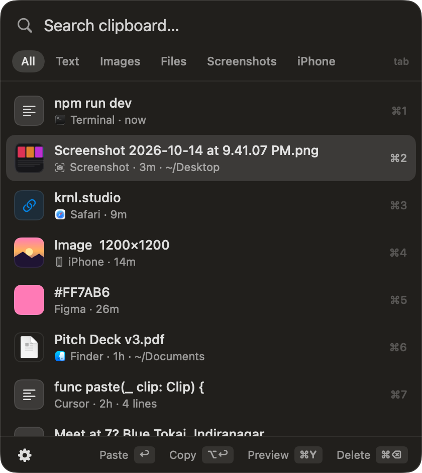
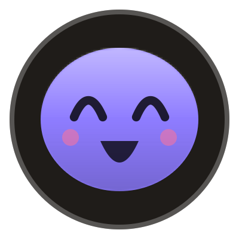
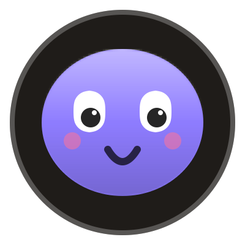
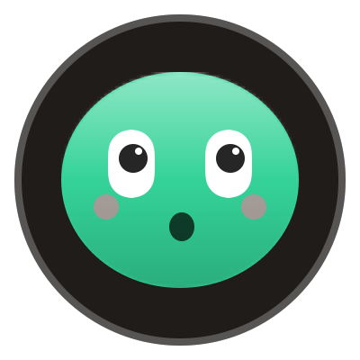
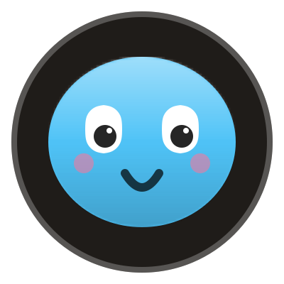
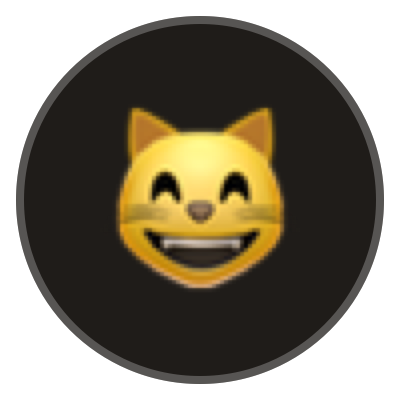
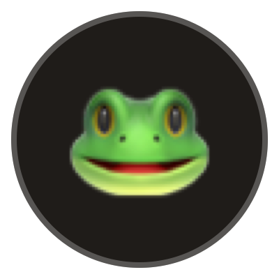
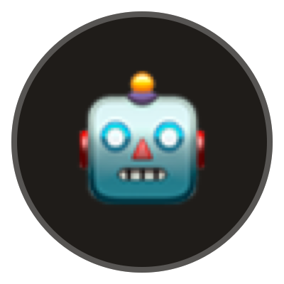

<p align="center">
  
</p>

<h1 align="center">ClipBubble</h1>

<p align="center">
  <b>A tiny bubble that remembers everything you copy.</b><br>
  Clipboard history for macOS with a mascot, a magnet, and an MCP server for your AI agents.
</p>

<p align="center">
  <a href="https://github.com/rohit3a/clipbubble/releases/latest">Download</a> ·
  <a href="https://clipbubble.krnl.studio">Website</a> ·
  <a href="#mcp-for-ai-agents">MCP</a> ·
  <a href="#mascots">Mascots</a>
</p>

<p align="center">
  
  &nbsp;&nbsp;
  
</p>

## What it does

- **A floating bubble with a pet.** It stays translucent in a screen corner until you need it. Drag it anywhere and it magnet-snaps to the nearest corner. When it catches a copy, the mascot hops and a badge counts up.
- **Remembers 7 days of everything.** Text, images, files, **every screenshot** (even the ones you never copied), and copies from your iPhone through Universal Clipboard.
- **Paste without hunting.** Press <kbd>⌃⌥V</kbd> anywhere, type to search, and press <kbd>↩</kbd>: it pastes straight into the app you were in. Or drag any item out into Slack, Figma or a browser upload.
- **Hover to peek** at your last three copies; one click pastes.
- **Built-in MCP server.** Claude Code, Codex, Cursor and Claude Desktop can read your clipboard history (and actually see the images), put things on your clipboard, and design new mascots for you.
- **Private and tiny.** Native Swift with zero dependencies. Everything lives in a local SQLite file, and nothing leaves your Mac. It skips password-manager copies and deletes everything after 7 days. It uses about 30 MB of RAM and 0% CPU at idle.

## Install

**Download:** grab `ClipBubble.zip` from [Releases](https://github.com/rohit3a/clipbubble/releases/latest), unzip it, and move `ClipBubble.app` to Applications. The app isn't notarized, so the first launch needs right-click → **Open**, or:

```bash
xattr -dr com.apple.quarantine /Applications/ClipBubble.app
```

**Or build from source** (needs the Xcode command line tools):

```bash
git clone https://github.com/rohit3a/clipbubble && cd clipbubble && ./build.sh
```

`build.sh` compiles the app, installs it to `~/Applications` and launches it. Requires macOS 14 or later.

**Permissions:** macOS asks for access to your screenshots folder (usually Desktop) so screenshots land in history. Auto-paste needs **Accessibility** access (System Settings → Privacy & Security → Accessibility); without it, picking an item just copies it.

## Keys

| Key | Action |
| --- | --- |
| <kbd>⌃⌥V</kbd> | Open or close the panel from anywhere |
| <kbd>↑</kbd> <kbd>↓</kbd> | Move the selection |
| <kbd>↩</kbd> | Paste into the app you were in |
| <kbd>⌥↩</kbd> | Copy only |
| <kbd>⌘1</kbd>–<kbd>⌘9</kbd> | Paste one of the first nine items |
| <kbd>⌘Y</kbd> | Full-size preview |
| <kbd>⌘⌫</kbd> | Delete from history |
| <kbd>Tab</kbd> | Next filter (All, Text, Images, Files, Screenshots, iPhone) |
| <kbd>Esc</kbd> | Close the preview, clear the search, or close the panel |

## Mascots

<p>
  
  
  
  
  
  
  
  
</p>

The blob family blinks, wiggles when you hover, squishes when you click and grins when it catches a copy. Switch mascots from the ⚙ menu in the panel, or add your own image (PNG, GIF, JPG or SVG; GIFs play while you interact with it).

Custom mascots are small JSON files in `~/Library/Application Support/ClipBubble/mascots/`:

```json
{ "id": "pinky", "name": "Pinky", "kind": "blob", "color": "#FF6AD5" }
{ "id": "owl", "name": "Owl", "kind": "emoji", "idle": "🦉", "active": "🤩" }
{ "id": "fox", "name": "Fox", "kind": "image", "idle": "fox-idle.svg", "hover": "fox-wave.gif" }
```

`hover` and `active` (shown on click or when a copy lands) fall back to `idle`.

## MCP for AI agents

The app binary doubles as a stdio MCP server. Register it once:

```bash
claude mcp add --scope user clipbubble -- ~/Applications/ClipBubble.app/Contents/MacOS/ClipBubble --mcp
```

For Codex: `codex mcp add clipbubble -- ~/Applications/ClipBubble.app/Contents/MacOS/ClipBubble --mcp`. For Claude Desktop or Cursor, add the same command with the argument `--mcp` to the MCP config.

| Tool | What it does |
| --- | --- |
| `clipboard_history` | Recent items, filterable by kind, source (`iPhone`, `Screenshot`, an app name), search text and time |
| `clipboard_get` | One item in full, including the image itself so the model can see it |
| `clipboard_set` | Put text or a history item on your clipboard |
| `mascot_list` / `mascot_set` | See and switch mascots |
| `mascot_add` / `mascot_remove` | Create mascots from a colour, emoji, image files or inline SVG |

Try asking your agent: *"Make my ClipBubble mascot a tiny pixel-art fox"* or *"What was that error I copied an hour ago?"*

## How it works

- `Sources/Capture.swift` polls the clipboard every 0.4 s and waits for it to settle first, so paste-through tools like Wispr Flow (which paste and then restore your clipboard) aren't disturbed and don't clutter history. Copies marked as concealed or transient by password managers are never stored.
- `Sources/Store.swift` keeps everything in `~/Library/Application Support/ClipBubble/clips.sqlite` (WAL mode, so the MCP server can read while the app writes). Copied images are stored as PNGs next to it.
- `Sources/UI.swift` has the bubble, the panel and the peek: non-activating panels, so your app keeps focus and ↩ can paste into it.
- `Sources/MCP.swift` is a small JSON-RPC server over stdio, with no SDK.
- `Sources/Mascot.swift` draws the mascots with plain SwiftUI shapes. When nobody is interacting, the only thing that animates is a blink every few seconds.

## License

[MIT](LICENSE). Made by [KRNL](https://krnl.studio).
